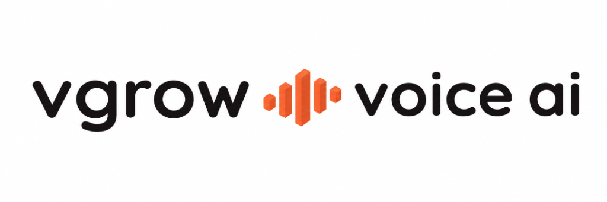

<div align="center">
  

  # 🎙️ VgrowVoice AI
  ### The Intelligent Voice Receptionist & Lead Capture SaaS

  [](https://nextjs.org/)
  [](https://twilio.com)
  [](https://ai.google.dev/)
  [](https://supabase.com)
</div>

---

## 🌟 Overview

**VgrowVoice** is a complete, white-labeled Voice AI SaaS built for modern businesses. It provides an autonomous, real-time AI receptionist capable of handling inbound customer calls, capturing outbound leads, scheduling appointments, and answering FAQs in multiple languages (including English, Telugu, and Hindi).

Built on top of **Google Gemini's Multimodal Live API**, VgrowVoice achieves sub-second latency for natural, human-like voice conversations over the phone.

---

## 🚀 Key Features

- 📞 **Real-Time Voice AI (Sub-second Latency):** Seamless inbound and outbound calling powered by Twilio Media Streams and Gemini Live.
- 🎯 **Native Campaign Form Builder:** A built-in drag-and-drop form builder for Meta/Google Ads. When a customer submits a lead form, the AI calls them instantly.
- 📅 **Automated Appointment Scheduling:** The AI dynamically fetches available business services and books appointments directly into the database.
- 🧠 **Anti-Hallucination Guardrails:** Strict prompt engineering ensures the AI *only* quotes real services, prices, and FAQs configured by the business owner.
- 🌍 **Multilingual Intelligence:** Native support for regional languages with intelligent language detection and switching mid-call.
- 🏢 **Multi-Tenant Architecture:** Built with Supabase RLS (Row Level Security), allowing thousands of businesses to operate securely on a single instance.
- 📊 **Real-time Call Transcripts:** Live streaming transcripts and AI-generated call summaries directly in the dashboard.
- 🔒 **Enterprise Security:** Ephemeral token authentication, Twilio signature verification, rate limiting, and authenticated API routes.

---

## 🛠️ Technology Stack

| Category | Technology |
|---|---|
| **Frontend Framework** | Next.js 14 (App Router) |
| **Styling** | Tailwind CSS + Lucide Icons + Framer Motion |
| **Database & Auth** | Supabase (PostgreSQL + RLS) |
| **Telephony** | Twilio (Programmable Voice + Media Streams) |
| **AI Intelligence** | Google Gemini (BidiGenerateContent WebSocket) |
| **State Management** | Zustand |
| **Testing** | Vitest |

---

## 🏗️ Architecture

VgrowVoice utilizes a hybrid monolith-microservice architecture designed for Google Cloud Run:

### Components

1. **Dashboard (Next.js):** 
   - Handles authentication, business configuration, lead management, and campaign forms
   - Serves the browser-based voice widget with ephemeral token authentication
   - Protected API routes with Supabase auth and business ownership verification

2. **Twilio Bridge (Node.js/WebSocket):**
   - High-performance WebSocket server that bridges Twilio's `µ-law` audio format with Gemini's `PCM` format in real-time
   - Executes Tool Calls (fetching business info, booking appointments) mid-conversation
   - Automatic reconnection with exponential backoff
   - Keepalive for long-duration calls

### Security Architecture

- **API Key Protection:** Gemini API keys never exposed to the browser. Server mints short-lived ephemeral tokens.
- **Request Authentication:** All admin API routes verify Supabase session and business ownership.
- **Webhook Verification:** Twilio webhook requests validated with X-Twilio-Signature.
- **Rate Limiting:** Public endpoints (campaign forms, widget config) include rate limiting by IP.
- **CORS Restrictions:** CORS headers limited to public widget endpoints only.

---

## 💻 Local Development

### Prerequisites

- Node.js 20+
- A Supabase Project
- A Twilio Account (with a purchased phone number)
- A Google AI Studio API Key (for Gemini)
- Ngrok (for local Twilio webhooks)

### Setup Instructions

1. **Clone the repository:**
   ```bash
   git clone https://github.com/Porallanagaraju13/Vgrow-Voice-AI.git
   cd Vgrow-Voice-AI
   ```

2. **Install dependencies:**
   ```bash
   npm ci
   ```

3. **Configure Environment Variables:**
   
   Copy `.env.example` to `.env.local` and fill in your credentials:
   ```bash
   cp .env.example .env.local
   ```

   Required environment variables:
   - `NEXT_PUBLIC_SUPABASE_URL` - Your Supabase project URL
   - `NEXT_PUBLIC_SUPABASE_ANON_KEY` - Supabase anonymous key
   - `SUPABASE_SERVICE_ROLE_KEY` - Supabase service role key (admin access)
   - `GEMINI_API_KEY` - Google Gemini API key (server-side only)
   - `TWILIO_ACCOUNT_SID` - Twilio account SID
   - `TWILIO_AUTH_TOKEN` - Twilio auth token
   - `TWILIO_PHONE_NUMBER` - Your Twilio phone number
   - `NGROK_URL` - Your ngrok URL for local development
   - `NEXT_PUBLIC_APP_URL` - Your application URL
   - `NEXT_PUBLIC_BRIDGE_URL` - Your bridge server URL
   - `BRIDGE_TOKEN_SECRET` - Random secret for bridge authentication

4. **Run Type Check and Tests:**
   ```bash
   npm run type-check
   npm run lint
   npm run test
   ```

5. **Start the Development Server & Bridge:**
   ```bash
   # Starts Next.js on port 3000 and the Twilio WS Bridge on port 3001
   npm run dev:all
   ```

---

## ☁️ Deployment

VgrowVoice is designed to be deployed to **Google Cloud Run** using a two-service architecture:

### Services

1. **vgrowvoice-web** - The frontend dashboard (Next.js)
2. **vgrowvoice-bridge** - The WebSocket streaming bridge (Node.js)

### Environment Variables for Production

**Web Service:**
- `NEXT_PUBLIC_SUPABASE_URL`
- `NEXT_PUBLIC_SUPABASE_ANON_KEY`
- `SUPABASE_SERVICE_ROLE_KEY`
- `GEMINI_API_KEY` (server-side only)
- `TWILIO_ACCOUNT_SID`
- `TWILIO_AUTH_TOKEN`
- `TWILIO_PHONE_NUMBER`
- `NEXT_PUBLIC_APP_URL`
- `NEXT_PUBLIC_BRIDGE_URL`

**Bridge Service:**
- `NEXT_PUBLIC_SUPABASE_URL`
- `SUPABASE_SERVICE_ROLE_KEY`
- `GEMINI_API_KEY`
- `TWILIO_AUTH_TOKEN` (for signature verification)
- `BRIDGE_TOKEN_SECRET`
- `PORT` (default: 3001)

### Security Notes

⚠️ **Never commit real secrets or API keys to version control.**

- Use Cloud Run secrets management for production credentials
- Rotate API keys regularly
- Monitor rate limits and unusual activity
- Enable Supabase Row Level Security (RLS) policies
- Use HTTPS for all endpoints
- Validate all Twilio webhooks with signature verification

---

## 🧪 Testing

Run the test suite:

```bash
npm run test          # Run tests once
npm run test:watch    # Watch mode
npm run test:ui       # Open Vitest UI
```

---

## 📝 License

This project is private and proprietary.

---

<div align="center">
  <i>Built with ❤️ for modern businesses.</i>
</div>
